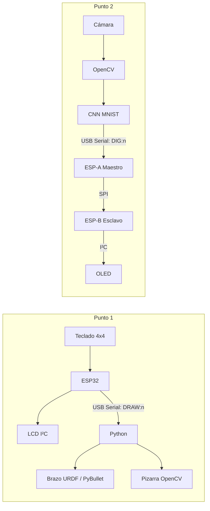
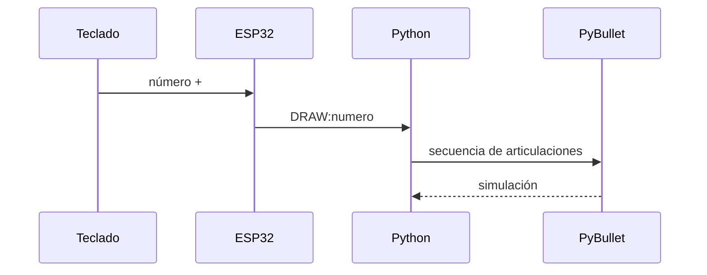
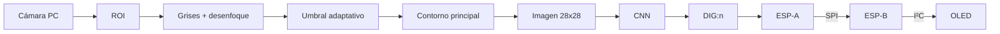

# 🤖 Actividad 6 – Teclado I²C + brazo dibujante y reconocimiento de dígitos con OpenCV, SPI y OLED

**Universidad Militar Nueva Granada – Ingeniería Mecatrónica**  
**Asignatura:** Micros y Laboratorio  
**Autor:** Kevin Philip Castelblanco Ramirez  
**Código:** 7004607  

---

## 📌 Descripción

La actividad está dividida en dos puntos.

| Punto | Función | Hardware principal | Software |
|---|---|---|---|
| **1 – Teclado + brazo** | Se escribe un número en un teclado 4x4, se visualiza en una LCD I²C y al presionar `#` se envía al PC para que un brazo URDF ejecute una secuencia de dibujo en PyBullet | ESP32, teclado 4x4, LCD 16x2 I²C | Arduino/C++, Python, PyBullet y OpenCV |
| **2 – Reconocimiento + SPI + OLED** | La cámara captura un dígito, OpenCV lo preprocesa, una CNN lo clasifica y el resultado se envía por Serial a una ESP32 maestra, luego por SPI a otra ESP32 que lo muestra en una OLED I²C | 2 ESP32, OLED SSD1306, cámara PC | Python, OpenCV, TensorFlow y Arduino/C++ |

> Esta implementación conserva la arquitectura solicitada en la guía, pero organiza el código en módulos propios y utiliza un protocolo serial/SPI sencillo.

---

## 📑 Contenido

1. [Arquitectura general](#1-arquitectura-general)
2. [Punto 1 – Teclado I²C y brazo en PyBullet](#2-punto-1--teclado-i²c-y-brazo-en-pybullet)
3. [Punto 2 – OpenCV, CNN, SPI y OLED](#3-punto-2--opencv-cnn-spi-y-oled)
4. [Materiales y software](#4-materiales-y-software)
5. [Instalación y ejecución](#5-instalación-y-ejecución)
6. [Explicación del código](#6-explicación-del-código)
7. [Estructura del repositorio](#7-estructura-del-repositorio)
8. [Problemas comunes](#8-problemas-comunes)
9. [Conclusiones](#9-conclusiones)
10. [Referencias](#10-referencias)

---

## 1. Arquitectura general



El PC se utiliza para las tareas de mayor procesamiento: simulación y visión computacional. Las ESP32 se encargan de la interacción con periféricos y de las comunicaciones.

---

## 2. Punto 1 – Teclado I²C y brazo en PyBullet

### 2.1 Funcionamiento

El usuario escribe un número en el teclado matricial. La LCD muestra el número mientras se escribe. Las teclas principales son:

| Tecla | Acción |
|---|---|
| `0–9` | Agregar dígitos |
| `*` | Borrar el último dígito |
| `#` | Enviar el número al PC para dibujarlo |
| `B` | Limpiar el número y la pizarra |

Cuando se presiona `#`, la ESP32 transmite:

```text
DRAW:123
```

Python recibe el comando y ejecuta la secuencia del brazo dentro de PyBullet. Paralelamente se muestra una pizarra mediante OpenCV.

### 2.2 Conexiones

| Elemento | ESP32 |
|---|---|
| Teclado filas 1–4 | GPIO 13, 14, 27, 26 |
| Teclado columnas 1–4 | GPIO 25, 33, 32, 23 |
| LCD SDA | GPIO 21 |
| LCD SCL | GPIO 22 |
| LCD VCC | 5 V |
| LCD GND | GND |

La dirección utilizada inicialmente para la LCD es `0x27`. Si la pantalla no responde, se debe verificar su dirección I²C.

### 2.3 Comunicación



---

## 3. Punto 2 – OpenCV, CNN, SPI y OLED

### 3.1 Flujo



La cámara captura la imagen. OpenCV recorta la zona central, convierte a escala de grises, aplica desenfoque y umbral adaptativo y selecciona el contorno de mayor tamaño. El dígito se centra y redimensiona a `28 × 28`.

La CNN clasifica el resultado entre `0` y `9`. Si la confianza supera el 80 %, el PC puede enviar:

```text
DIG:5
```

### 3.2 SPI

La ESP-A actúa como **maestro** y la ESP-B como **esclavo**.

| Señal | ESP-A | ESP-B |
|---|---:|---:|
| CS | GPIO 5 | GPIO 5 |
| SCK | GPIO 18 | GPIO 18 |
| MOSI | GPIO 23 | GPIO 23 |
| MISO | GPIO 19 | GPIO 19 |
| GND | GND | GND |

La trama propia utilizada contiene tres bytes:

```text
0xA5 | DIGITO | CHECKSUM
```

donde:

```text
CHECKSUM = 0xA5 XOR DIGITO
```

Esto permite descartar una trama básica si el contenido recibido no coincide.

### 3.3 OLED

La OLED SSD1306 se conecta a la ESP-B:

| OLED | ESP-B |
|---|---|
| VCC | 3.3 V |
| GND | GND |
| SDA | GPIO 21 |
| SCL | GPIO 22 |

Dirección I²C utilizada:

```text
0x3C
```

---

## 4. Materiales y software

### Hardware

- 3 ESP32 en total si se montan ambos puntos simultáneamente.
- Teclado matricial 4x4.
- LCD 16x2 con módulo I²C.
- OLED SSD1306 128x64 I²C.
- Protoboard y jumpers.
- Cámara integrada o USB del computador.
- Cables USB de datos.

### Software

- Arduino IDE o VS Code + PlatformIO.
- Python 3.
- PyBullet.
- OpenCV.
- NumPy.
- PySerial.
- TensorFlow/Keras.

---

## 5. Instalación y ejecución

### 5.1 Dependencias Python

Desde la raíz:

```bash
pip install -r requirements.txt
```

### 5.2 Punto 1

Cargar en la primera ESP32:

```text
Punto_1_Teclado_Brazo/firmware/punto1_teclado.ino
```

Luego:

```bash
cd Punto_1_Teclado_Brazo
python brazo_dibujante.py --port COM5
```

Cambiar `COM5` por el puerto real.

También se puede probar la simulación sin ESP32:

```bash
python brazo_dibujante.py --sin-serial
```

### 5.3 Punto 2 – Entrenar CNN

```bash
cd Punto_2_Digitos_SPI/pc
python entrenar_modelo.py
```

Se genera:

```text
modelo_mnist_cnn.h5
```

### 5.4 Cargar ESP-B

Cargar:

```text
Punto_2_Digitos_SPI/esp_b_esclavo/esp_b_esclavo.ino
```

### 5.5 Cargar ESP-A

Cargar:

```text
Punto_2_Digitos_SPI/esp_a_maestro/esp_a_maestro.ino
```

### 5.6 Ejecutar reconocimiento

```bash
cd Punto_2_Digitos_SPI/pc
python reconocer_digito.py --port COM5
```

Para probar únicamente la cámara:

```bash
python reconocer_digito.py --sin-esp
```

---

## 6. Explicación del código

### 6.1 Firmware del Punto 1

`punto1_teclado.ino` utiliza `Keypad` para leer la matriz 4x4 y `LiquidCrystal_I2C` para actualizar la pantalla.

Al presionar `#`:

```cpp
Serial.println("DRAW:" + numero);
```

Esto evita enviar continuamente información innecesaria.

### 6.2 Simulación

`brazo_dibujante.py` carga el URDF mediante:

```python
robot = p.loadURDF("../../urdf/brazo.urdf", [0,0,0], useFixedBase=True)
```

El movimiento se realiza con control de posición de las articulaciones:

```python
p.setJointMotorControl2(
    robot,
    articulacion,
    p.POSITION_CONTROL,
    posicion
)
```

### 6.3 Preprocesamiento OpenCV

El Punto 2 utiliza:

```python
gris = cv2.cvtColor(roi, cv2.COLOR_BGR2GRAY)
blur = cv2.GaussianBlur(gris, (5,5), 0)
bw = cv2.adaptiveThreshold(
    blur, 255,
    cv2.ADAPTIVE_THRESH_GAUSSIAN_C,
    cv2.THRESH_BINARY_INV,
    11, 4
)
```

Luego se obtiene el contorno principal y se transforma a una imagen de `28 × 28`, compatible con MNIST.

### 6.4 CNN

La red utilizada contiene:

```text
Entrada 28x28x1
↓
Conv2D 32
↓
MaxPooling
↓
Conv2D 64
↓
MaxPooling
↓
Flatten
↓
Dense 128
↓
Dropout
↓
Dense 10 + Softmax
```

La salida representa las probabilidades de los diez dígitos.

### 6.5 Comunicación SPI

El maestro transmite:

```cpp
SPI.transfer(0xA5);
SPI.transfer(digito);
SPI.transfer(0xA5 ^ digito);
```

El esclavo comprueba que:

```text
byte 3 = byte 1 XOR byte 2
```

Si la trama es válida, actualiza la OLED.

---

## 7. Estructura del repositorio

```text
Actividad6/
├── README.md
├── requirements.txt
├── urdf/
│   └── brazo.urdf
├── Punto_1_Teclado_Brazo/
│   ├── firmware/
│   │   └── punto1_teclado.ino
│   └── brazo_dibujante.py
└── Punto_2_Digitos_SPI/
    ├── esp_a_maestro/
    │   └── esp_a_maestro.ino
    ├── esp_b_esclavo/
    │   └── esp_b_esclavo.ino
    └── pc/
        ├── entrenar_modelo.py
        └── reconocer_digito.py
```

---

## 8. Problemas comunes

| Problema | Solución |
|---|---|
| LCD enciende pero no muestra texto | Revisar dirección `0x27` y ajustar contraste |
| Python no abre COM | Cerrar Monitor Serial y revisar el puerto |
| PyBullet no encuentra el URDF | Ejecutar Python desde `Punto_1_Teclado_Brazo` |
| `No module named cv2` | `pip install opencv-python` |
| `No module named serial` | `pip install pyserial` |
| OLED no muestra el dígito | Revisar `0x3C`, SDA/SCL y alimentación |
| SPI no funciona | Verificar GND común, CS, SCK, MOSI y MISO |
| CNN no reconoce bien | Usar marcador oscuro, fondo claro y buena iluminación |
| Cámara no abre | Cerrar otras aplicaciones que estén usando la webcam |

---

## 9. Conclusiones

- Se integraron periféricos I²C, comunicación serial y SPI dentro de una misma actividad.
- El primer punto permite relacionar una entrada física desde un teclado con una simulación robótica en PyBullet.
- El segundo punto separa el procesamiento de visión del manejo del hardware: el computador reconoce el dígito y las ESP32 transportan y muestran el resultado.
- OpenCV permite acondicionar la imagen antes de enviarla a la red neuronal.
- La comunicación SPI maestro-esclavo permite transferir el resultado entre dos microcontroladores de forma sencilla.
- El proyecto puede ampliarse posteriormente con trayectorias de dibujo más precisas, reconocimiento de varios dígitos y confirmaciones SPI más completas.

---

## 10. Referencias

- Espressif Systems – ESP32 Documentation.
- OpenCV Documentation.
- TensorFlow / Keras Documentation.
- PyBullet Quickstart Guide.
- ROS – URDF documentation.
- Adafruit SSD1306 Library.
- Arduino Keypad Library.

---

**Kevin Philip Castelblanco Ramirez**  
**Código: 7004607**  
**Ingeniería Mecatrónica – Universidad Militar Nueva Granada**
